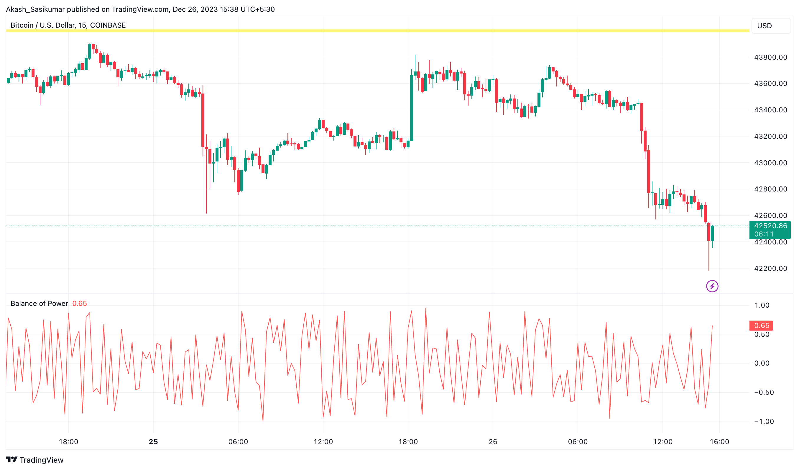
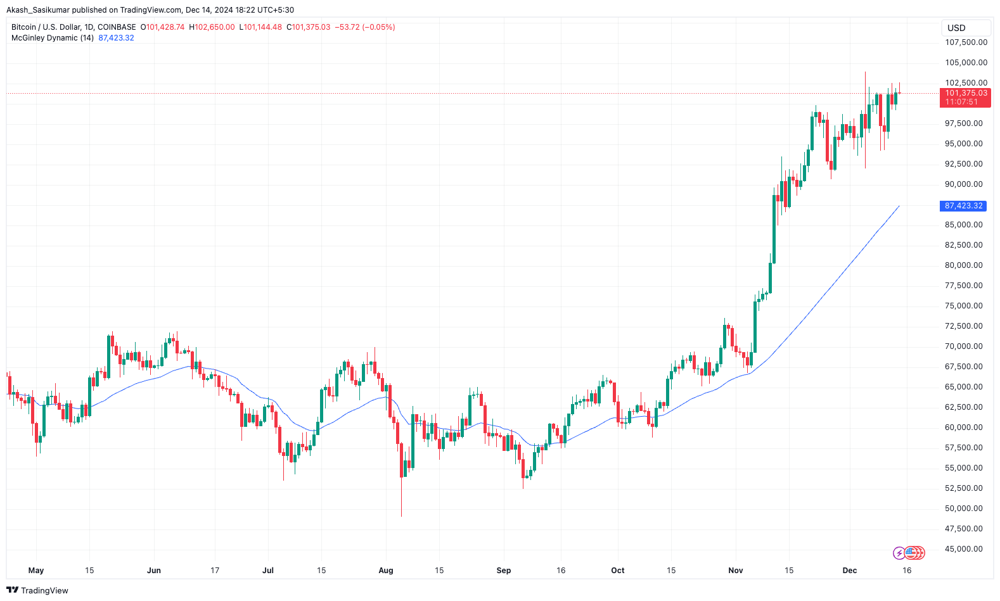
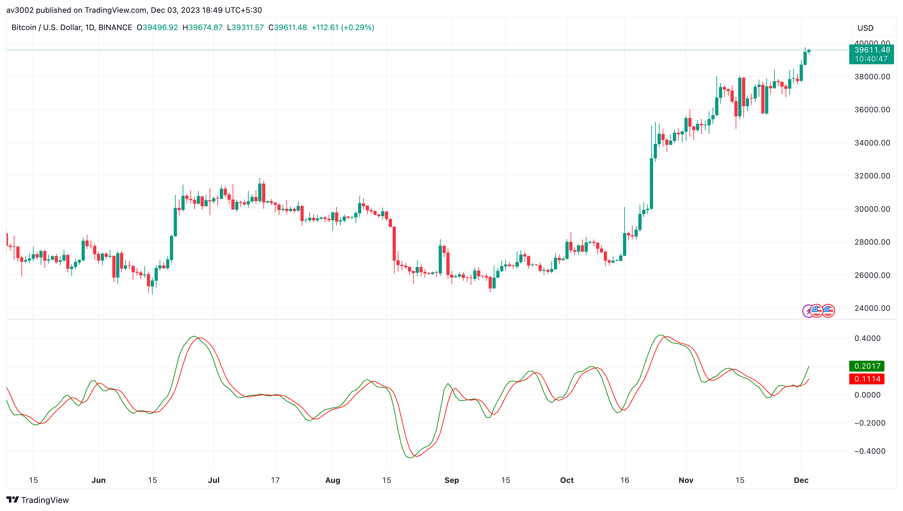
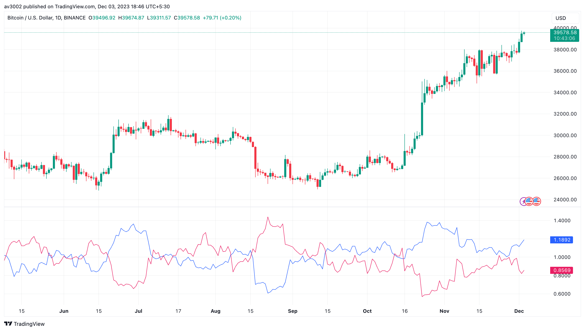
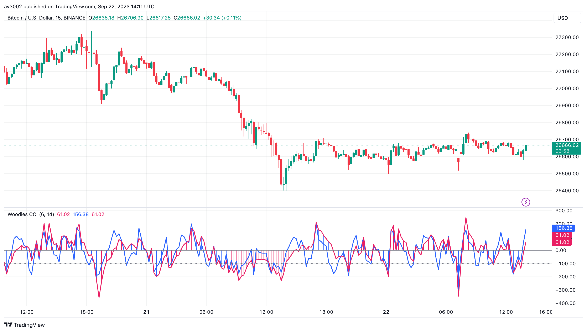

# Pine Strategy Indicators v7

Five open-source TradingView indicators written in Pine Script v6: Balance of Power, McGinley Dynamic, Relative Vigor Index, Vortex Indicator and Woodies CCI. Part of [GAINZ](https://gainz-trading-indicators.vercel.app), 35 indicators across seven collections.

| Indicator                                     | Type     | Script                                                              |
| --------------------------------------------- | -------- | ------------------------------------------------------------------- |
| [Balance of Power](#balance-of-power)         | Momentum | [`balance-of-power.pine`](indicators/balance-of-power.pine)         |
| [McGinley Dynamic](#mcginley-dynamic)         | Trend    | [`mcginley-dynamic.pine`](indicators/mcginley-dynamic.pine)         |
| [Relative Vigor Index](#relative-vigor-index) | Momentum | [`relative-vigor-index.pine`](indicators/relative-vigor-index.pine) |
| [Vortex Indicator](#vortex-indicator)         | Trend    | [`vortex-indicator.pine`](indicators/vortex-indicator.pine)         |
| [Woodies CCI](#woodies-cci)                   | Momentum | [`woodies-cci.pine`](indicators/woodies-cci.pine)                   |

## Balance of Power

Close minus open, divided by high minus low: a bar-by-bar score of who was in control, buyers or sellers.

Above zero, buyers pushed price up through the bar; below zero, sellers did. The longer it stays on one side, the clearer the winner.

| Setting | Default           |
| ------- | ----------------- |
| Formula | (C − O) / (H − L) |

Based on TradingView's built-in Balance of Power indicator.

## McGinley Dynamic

A moving average that tunes its own speed to the market, hugging price without the usual whipsaws.

Read it like a smarter moving average: above it is an uptrend, below it a downtrend, and it rarely gets left behind on fast moves.

| Setting | Default |
| ------- | ------- |
| Length  | 14      |

Based on TradingView's built-in McGinley Dynamic indicator.

## Relative Vigor Index

Compares where each bar closes against where it opened, relative to its range, with a signal line alongside.

In uptrends bars tend to close above their open. RVGI crossing over its signal line is bullish; crossing under is bearish.

| Setting | Default |
| ------- | ------- |
| Length  | 10      |

Based on TradingView's built-in Relative Vigor Index indicator.

## Vortex Indicator

Two lines, VI+ and VI−, that measure upward and downward movement from one bar to the next.

VI+ crossing above VI− starts an uptrend; the opposite cross starts a downtrend. The wider the gap, the stronger the move.

| Setting | Default |
| ------- | ------- |
| Length  | 14      |

Based on TradingView's built-in Vortex Indicator indicator.

## Woodies CCI

Two CCIs in one pane, a fast 6-bar turbo and a 14-bar main line, with zero and ±100 lines for Woodie's patterns.

Trade on the side of zero the main line is on. The turbo line bouncing off zero inside that trend is the classic entry.

| Setting      | Default |
| ------------ | ------- |
| Turbo length | 6       |
| CCI length   | 14      |

Based on TradingView's built-in Woodies CCI indicator.

## How to use

1. Open the indicator's `.pine` file in `indicators/` and copy the code.
2. In TradingView, open the Pine Editor, paste the code and save it.
3. Click **Add to chart**, then change the defaults in the indicator's settings.

## Disclaimer

For learning and research. Indicators describe what price has done, not what it will do. Nothing here is financial advice.

## License

[MIT](LICENSE). Indicators based on someone else's work keep their original author's terms.
